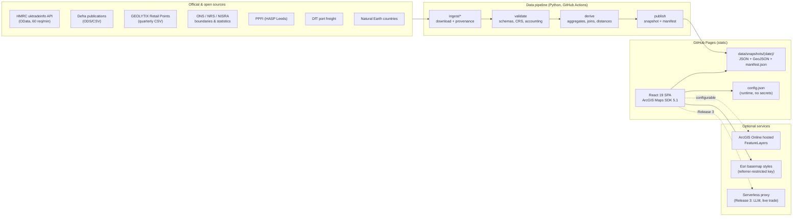
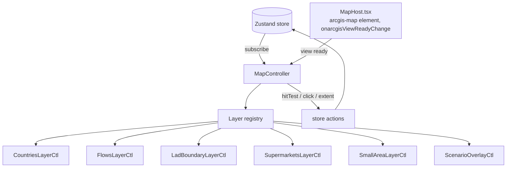

# FOODSCOPE UK — Architecture

| | |
|---|---|
| **Document** | 02 — Architecture |
| **Version** | 0.1 — planning baseline, 23 October 2026 |
| **Status** | Draft; decisions marked *ADR* are proposed until accepted at the end of Stage 1 |

---

## 1. System overview

FOODSCOPE UK is a **static-first** application: a React single-page app served from GitHub Pages, reading versioned data snapshots that a separate Python pipeline builds from official sources on a schedule. Nothing in the browser needs a secret or calls a rate-limited government API directly.



### 1.1 Why static-first

- **Rate limits and paging**: the HMRC API allows 60 requests per minute per user and pages at 40,000 records (verified, §S01). A public demo must not depend on that at runtime.
- **CORS**: browser access to `api.uktradeinfo.com` is unverified. A pipeline avoids the question entirely.
- **Reproducibility and provenance**: every figure on screen traces to a dated snapshot with checksums, which is what a government audience needs.
- **Cost and security**: GitHub Pages is free, static and has no server to secure.

---

## 2. Verified technology stack

Versions checked on the npm registry on **23 October 2026**. The lockfile pins exact versions; the table shows the intended range.

| Concern | Package | Version | Notes |
|---|---|---|---|
| Mapping core | `@arcgis/core` | **5.1.27** (`~5.1.27`) | ESM only. 5.1 released June 2026; minor releases have no breaking changes (Esri). 5.2 is in `rc`. |
| Map components | `@arcgis/map-components` | **5.1.27** (`~5.1.27`) | Peer deps: `@arcgis/core ^5.1.0`, `@esri/calcite-components ^5.1.1`. Ships React JSX typings at `@arcgis/map-components/types/react`. |
| Common components | `@arcgis/common-components` | 5.1.27 | Transitive dependency of map components; declared directly so its asset path can be set in local-asset mode (ADR-0014). |
| Design system | `@esri/calcite-components` | **5.1.2** (`~5.1.2`) | Esri's version matrix pairs SDK 5.1 with Calcite 5.1; npm `latest` is 5.2.0, so **pin to 5.1.x** to stay aligned. |
| UI framework | `react`, `react-dom` | 19.3.1 (`^19.3.0`) | React 19 supports custom elements natively. |
| Build | `vite` | 8.3.5 (`^8.3.0`) | |
| | `@vitejs/plugin-react` | 6.1.2 | Requires Vite ^8. |
| Language | `typescript` | **6.0.3** (`~6.0.3`) | npm `latest` is 7.0.2, but `typescript-eslint` 8.72 supports `<6.1.0`. **Do not use TS 7** until the lint toolchain supports it. |
| Lint | `eslint` 10.x, `typescript-eslint` 8.72 | | Flat config. |
| Charts | `echarts` | 6.1.0 | Imported from `echarts/core` with only the charts/components used; thin in-house `useEChart` hook (no wrapper dependency). |
| Server state | `@tanstack/react-query` | 5.104.x | Static snapshots: `staleTime: Infinity`. |
| Client state | `zustand` | 5.0.x | Slices + URL sync middleware. |
| Icons | `lucide-react` | 1.61.x | |
| Geometry helpers | `@turf/*` modular packages | 7.4.x | Only where the ArcGIS geometry operators are unsuitable (e.g. pure-function tests). |
| Validation | `ajv` | 8.20.x | Runtime validation of loaded snapshots against JSON Schema. |
| Types from schemas | `json-schema-to-typescript` | 16.x | Generates `src/types/generated/*`. |
| PDF | `jspdf` | 4.2.x | Programmatic layout (not DOM screenshots). |
| Unit tests | `vitest` | 5.0.x | jsdom for components; pure node for analysis. |
| Component tests | `@testing-library/react` | 16.3.x | |
| E2E | `@playwright/test` | 1.64.x | Chromium with software WebGL in CI. |
| Fonts | `@fontsource/ibm-plex-sans`, `@fontsource/ibm-plex-mono` | 5.3.0 | Self-hosted. |
| Build helpers | `vite-plugin-static-copy` 4.1.1, `prettier` 3.9, `@axe-core/playwright` 4.14 | dev | Local asset copy, formatting, accessibility checks. |
| Reference geometry | `world-atlas` 2.0.2 + `topojson-client` 3.1.0 | dev | Natural Earth 4.1.0 1:110m outlines converted by `scripts/build-reference-layers.mjs` (S24). |
| Pipeline | Python 3.12, `uv`, `geopandas`, `shapely` 2, `pyproj`, `duckdb`, `httpx`, `pydantic`, `jsonschema` | pinned in `pipeline/uv.lock` | Network routing libraries (`osmnx`, `r5py`) added only in Release 3. |

### 2.1 ArcGIS 5.x facts that shape the code (verified)

- All widgets were **deprecated in 5.0**; Esri targets removal as early as Q1 2027. FOODSCOPE uses **map components only** (`<arcgis-map>`, `<arcgis-legend>`, `<arcgis-search>`, `<arcgis-zoom>`, `<arcgis-scale-bar>`, `<arcgis-time-slider>` etc.) or bespoke React controls.
- AMD/`require()` and the `__esri` type namespace are deprecated in 5.0 and removed in 6.0 — use ESM imports and named types only.
- `@arcgis/map-components-react` is still published (5.1.27) but Esri staff state it is not necessary for React 19. The brief excludes it; FOODSCOPE uses the custom elements directly.
- Component registration: `import "@arcgis/map-components/components/arcgis-map";` (package exports `./components/*`).
- JSX typing: add `/// <reference types="@arcgis/map-components/types/react" />` to `src/vite-env.d.ts`.
- Event props in JSX use the lowercase-prefixed custom event form, e.g. `onarcgisViewReadyChange`, `onarcgisReady` (confirmed in the package's React typings).
- 5.1 adds `CIMSymbolAnimationMoveAlongLine` (beta) for animating markers along lines. In the Stage 2 spike no CIM symbol animation rendered in our view (headless SwiftShader and an Intel GPU), so flow motion is drawn on a canvas overlay (ADR-15).
- 2D feature layers support clustering via feature reduction; client-side `GeoJSONLayer`/`FeatureLayer` sources are sufficient for ~20k points.
- *Verified in Stage 1*: a `MapView` whose map has no basemap never becomes ready unless `constraints.lods` is set (Esri's `MapViewConstraints` docs say so); `MapHost` supplies Web Mercator LODs from `TileInfo.create()`.
- *Verified in Stage 1*: runtime assets default to `js.arcgis.com/5.1.27/…` and `js.arcgis.com/calcite-components/5.1.2/`; each package exposes `setAssetPath` (core: `esriConfig.assetsPath`) for self-hosting (ADR-0014).

---

## 3. Architecture decision records (summary)

| ADR | Decision | Rationale | Consequences |
|---|---|---|---|
| **ADR-01** | Static-first hosting with pipeline-built snapshots | §1.1 | Data latency = pipeline cadence; "live" mode only via optional proxy in Release 3 |
| **ADR-02** | ArcGIS map components used directly in React 19; no widgets; no React wrapper | Brief §3; 5.0 deprecations | Need a small typed bridge for view access and events |
| **ADR-03** | **One-way sync**: Zustand store is the source of truth; map controllers subscribe and mutate ArcGIS layers; ArcGIS events dispatch store actions | Brief step 8 (keep map and React state synchronised) | No ArcGIS objects in React state; controllers are testable in isolation |
| **ADR-04** | Single 2D `MapView` in Web Mercator for all modules; `<arcgis-scene>` globe added in Release 2 for Food Origins only | Smooth global→local flights, one basemap | Quantities never encoded by country area; equal-area exports deferred |
| **ADR-05** | Flows as client-side polyline graphics: symbolic quadratic curves in Web Mercator (deliberately not great-circle routes) from each partner's Natural Earth label point to one UK point; width linear in the measure (1.5–12 px) | Honest, performant, reduced-motion friendly | Arcs are symbolic (P4); anchor is a single UK point, not ports |
| **ADR-15** | Flow motion on a 2D canvas overlay synced with `view.toScreen`, stopped under reduced motion; static lines stay ArcGIS graphics | SDK 5.1 CIM animations did not render in our view (Stage 2 spike) | If the overlay fails only the motion is lost |
| **ADR-16** | HMRC ingest on GitHub Actions (`refresh-trade-data.yml`); raw responses committed in `pipeline/raw/hmrc/<snapshot>/`; offline rebuild and reconciliation | Sandbox cannot reach HMRC; browser must not; reproducible audit trail | ~0.2 MB per snapshot in git |
| **ADR-17** | Seasonal Supply: only connection widths ease between months (≤ 320 ms, instant under reduced motion), ending exactly at the model values; fills, numbers and labels switch at once; fixed width scale and fixed heatmap classes across months and years; missing months never estimated | Brief: "smooth … but statistically accurate"; SS-02, P11, P12 | A line can be briefly drawn between two months' widths; E2E verifies start and exact end, the easing is unit tested |
| **ADR-18** | Trade views frame the UK and the drawn connections (fit into the area free of panels, KPI cards, timeline and the desktop legend); reframed only on a new commodity or on request (map control, F key) | Review 23 Oct 2026: connections covered 1.9 % of the map at world scale | A small partner beyond the top N can be off screen; the globe control shows the world |
| **ADR-19** | One opaque share ramp (`--fs-seq-*`, mirrored in `palette.ts`) for map, legend and heatmap; hover by view highlight; first view's data prefetched before React and in parallel with the SDK | Review: smallest class 1.27:1 against the land; KPI cards waited ~2.9 s behind the SDK | Opaque fills hide the basemap texture under partners; the map view can be ready up to ~0.3 s later on a fast CPU |
| **ADR-20** | Local data: BGC (clipped) councils for display, BFE (full extent) for store assignment in EPSG:27700; D5 classes from `size_band`, formats from `fascia`; ONS mid-2025 population for all four nations; built offline by `build-local` into `public/data/snapshots/<snapshot>/local/` and published with Stage 4 | Coastlines on the map, no store lost at the shore; one population year across nations; the Evidence page lists only data on screen | `publish` combines snapshots by family (ADR-21); ~50 MB of raw inputs in git |
| **ADR-21** | Each data family (`snapshots/<date>/trade/`, `…/local/`) comes from its own newest snapshot; the manifest's `snapshots` maps family → date | John's decision: trade and stores refresh on their own schedules | The header and Evidence page show one date per family |
| **ADR-22** | A validated colour set per basemap style (`MAP_COLOURS`, `--fs-map-*`, `data-map-style`); one local-scale rule (zoom 12) for individual stores, council outlines and imagery; `BasemapStatusController` swaps `map.basemap`; nested map syncs are deferred | SH-08: light grey and imagery need their own colours; stores and council fills compete at local scale | Every new map colour needs a value per style; basemap tests stub the Esri styles service |
| **ADR-23** | Local Authority Profiles: `areas` (one folder per council, loaded on selection), `context` and `register` families; the Food Access layers in a profile mode (outlines, selected and comparison councils); small areas as a GraphicsLayer from `state.profileMap`; chart clicks outline areas; the camera fits each selected council up to zoom 13; straight-line distances computed in the browser in BNG or ITM | Stage 5 brief: any council, deep profiles for Belfast and Manchester, map-linked charts, scalable to four nations; GeoJSON hit tests are slow (B29) | Adding a deep profile is a pipeline change only (same geographies); the 110m outlines stop at zoom 8; NI grocers draw from zoom 7.5 |
| **ADR-24** | Risk Explorer: three views kept apart (`rv`), no composite (RK-05 deferred); the supply view reuses the trade map with a water-stress fill (`originsMap.fill`); `RiskLogisticsController` draws ports (graphics, the only hit-tested layer), road corridors and farming regions from `state.riskMap`; councils in a `risk` mode of the Access layers; a warm risk ramp for vulnerability measures; explanations built from `Indicator`s, interpretation separate | John's Stage 6 brief: three views with maps, KPIs, linked charts and "Explain this risk"; weights only for comparable composites | New risk datasets need a schema, validator and indicator builder; heatmaps carry a hidden class visualMap (ECharts requirement) |
| **ADR-06** | **JSON Schema is the canonical data contract** (`/schemas`); pipeline validates with `jsonschema`/pydantic, app generates TS types and validates at load with ajv | Two languages, one contract | Schema changes are versioned and tested on both sides |
| **ADR-07** | Python pipeline for data; TypeScript for the app | GeoPandas/DuckDB/pyproj are the right tools for boundaries, reprojection and spatial joins | Two toolchains; CI runs both |
| **ADR-08** | Data access through adapters: `StaticSnapshotAdapter` (default), `ArcGISFeatureLayerAdapter` (URL from `config.json`); future `ProxyAdapter` | Brief §7 and §15 configurability | Feature code never knows where data came from |
| **ADR-09** | Every value travels in an `Indicator<T>` envelope with provenance; `<Metric>` refuses to render without it (dev assertion, prod fallback "source unavailable") | P1/P2 | Slightly more verbose data structures |
| **ADR-10** | PDF built programmatically from the same `ProfileModel` as the screen; checksum in footer | Brief §9H exact match | Layout code for PDF separate from React layout |
| **ADR-11** | Auth: referrer-restricted ArcGIS Location Platform API key for basemaps, **never committed**: injected at build time from the GitHub Actions secret `ARCGIS_API_KEY` (local dev: git-ignored `.env.local`); hosted layers public or via user OAuth sign-in; publishing credentials only in CI secrets | Brief §3, §15. The key is visible in the deployed bundle by design (client apps must send it), so referrer restriction and minimal privileges are the real controls; keeping it out of git avoids leaking it in history and eases rotation | Keys expire after at most one year — rotation runbook in `docs/setup/arcgis-api-key.md`; local dev uses `localhost` referrers |
| **ADR-12** | Release 1 uses straight-line proximity only; network times are pre-computed in the pipeline in Release 3 (no bulk client-side routing with an embedded key) | Accessibility honesty (P7), cost control | UI must label proximity measures clearly |
| **ADR-13** | Query-string state, no path routing | GitHub Pages has no rewrites; deep links needed for demos | `?m=origins&c=tomatoes&y=2025&mo=7` style URLs |
| **ADR-14** | SDK assets from the Esri CDN in production; `VITE_ARCGIS_ASSETS=local` copies them into the build for tests/offline | Esri recommends the CDN; self-hosting adds ~130 MB; sandboxes cannot reach the CDN | Two build modes; CI E2E uses local mode, post-deploy smoke test covers CDN mode |

Full ADR texts live in `docs/adr/` (one file per decision, MADR format; index in `docs/adr/README.md`).

---

## 4. Repository structure

Adapted from brief §18. Folders marked † are created in later stages.

```text
FoodScopeUK/                       # repository root
├── CLAUDE.md                      # instructions for Claude Code (read first)
├── README.md                      # setup, data, refresh, licensing, limitations
├── docs/
│   ├── 00-ORIGINAL-BRIEF.md
│   ├── 01-SPECIFICATION.md
│   ├── 02-ARCHITECTURE.md
│   ├── 03-DATA-SOURCES.md
│   ├── 04-ROADMAP.md
│   ├── adr/                       # one MADR file per decision
│   └── stage-reports/             # what each stage delivered and verified
├── schemas/                       # JSON Schema: canonical data contracts (ADR-06)
├── pipeline/                      # Python data pipeline (uv project)
│   ├── pyproject.toml / uv.lock
│   ├── foodscope_pipeline/
│   │   ├── sources/               # one module per source (hmrc.py, geolytix.py, ons.py…)
│   │   ├── derive/                # aggregation, spatial joins, distances
│   │   ├── publish.py             # writes snapshot + manifest.json
│   │   └── accounting.py          # rows in/out per stage
│   ├── config/commodities.yaml    # commodity baskets (§6.1 of spec)
│   └── tests/
├── public/
│   ├── config.json                # runtime config (no secrets)
│   ├── data/
│   │   ├── manifest.json          # current snapshot pointer + source catalogue
│   │   └── snapshots/<YYYY-MM-DD>/…
│   └── assets/                    # brand, commodity icons
├── src/
│   ├── main.tsx
│   ├── vite-env.d.ts              # includes ArcGIS React JSX type reference
│   ├── app/                       # App shell, providers, URL sync, error boundaries
│   ├── components/
│   │   ├── layout/                # TopBar, Sidebar, InsightsPanel, TimelineBar
│   │   ├── dashboard/             # KpiCard, Metric, SourceBadge, ProvenanceBadge
│   │   ├── maps/                  # MapHost (<arcgis-map>), MapLegend, MapStatusTray
│   │   ├── charts/                # useEChart, Heatmap, TrendLine, BarCompare
│   │   ├── controls/              # CommoditySelector, MonthStepper, RetailerFilter…
│   │   └── states/                # Skeleton, EmptyState, ErrorState, StaleBanner
│   ├── features/
│   │   ├── food-origins/
│   │   ├── seasonal-supply/
│   │   ├── supermarkets/
│   │   ├── food-access/
│   │   ├── authority-profiles/
│   │   ├── risks/                 # Stage 6 Risk Explorer (as built: src/features/risks/)
│   │   ├── vulnerabilities/       †
│   │   ├── scenarios/
│   │   ├── consulting-insights/
│   │   └── ask-foodscope/         †
│   ├── map/                       # MapController, layer controllers, layer registry
│   ├── services/
│   │   ├── config/                # load + validate config.json
│   │   ├── data/                  # adapters (static, feature layer), manifest loader
│   │   └── arcgis/                # view access, goTo choreography, screenshot
│   ├── analysis/                  # PURE functions: shares, HHI, distances, scenarios
│   ├── state/                     # Zustand slices + URL sync
│   ├── content/                   # workstreams.json, caveats.json, glossary.json
│   ├── styles/                    # tokens.css, calcite-theme.css, glass.css
│   └── types/                     # domain types + generated/
├── tests/
│   ├── fixtures/                  # REAL source samples with retrieval date
│   ├── unit/ …                    # (or co-located *.test.ts)
│   └── e2e/                       # Playwright
├── .github/workflows/
│   ├── ci.yml                     # typecheck, lint, unit, build, e2e
│   ├── deploy-pages.yml           # build + deploy to GitHub Pages
│   └── refresh-data.yml           # scheduled pipeline → PR with data diff
├── package.json / package-lock.json
├── vite.config.ts / tsconfig.json / eslint.config.js / playwright.config.ts
└── .env.example                   # build-time vars only (no secrets)
```

Rules:

- `src/analysis/` never imports ArcGIS, React or browser APIs. It is where correctness lives and where tests concentrate.
- `src/features/<module>/` owns its panels, hooks and a `layers.ts` that declares which layer controllers it activates.
- `src/map/` is the only place that creates or mutates ArcGIS layers.

---

## 5. Front-end design

### 5.1 State model (Zustand)

```ts
type ModuleId = "origins" | "seasonal" | "access" | "risks" | "profiles" | "scenarios" | "insights";

interface AppState {
  ui:        { module: ModuleId; sidebarOpen: boolean; insightsOpen: boolean; motion: "auto" | "reduced"; };
  selection: { commodity: CommodityId; year: number; month: number | null; period: "month" | "rolling12" | "year";
               compareYear: number | null; lad: GssCode | null; compareLads: GssCode[]; storeId: string | null; };
  filters:   { retailers: string[]; storeClasses: StoreClass[]; thresholdsKm: number[]; metric: "mass" | "value"; };
  scenario:  { id: ScenarioId | null; params: Record<string, number | string>; };
  // actions…
}
```

- Only serialisable values live in the store. ArcGIS objects (view, layers, graphics) live in controllers.
- **As built (Stage 2):** a flat store (`src/state/store.ts`). URL state (`src/state/urlState.ts`) is `module`, `month`, `lad`, `overlay` and, for Food Origins, `commodity` (`c`), `period` (`pm` = `r12` | `m` | `y`), `year` (`y`), `measure` (`ms`) and `partner` (`p`). Non-URL state includes `originsMap` — a serialisable map view model (partners with share class, label point, connection width) that the Origins feature writes and the map controller reads — `hoverPartner` and `flowCount`.
- **As built (Stage 3):** Seasonal Supply shares `commodity`, `year`, `month`, `measure` and `partner` with Food Origins and adds `compareYear` (`cy`, default: the year before), `compareMonth` (`cm`) and `heatmap` (`hm` = `share` | `amount` | `change`). Playback (`playing`, `playSpeed`) is not in the URL, so a shared link never starts playing. Every setter that changes what is shown (month, year, commodity, measure, comparison, module, URL navigation) stops playback; `playbackStep` advances it. Seasonal writes the selected month's map model to the same `originsMap` slot, built with `buildOriginsModel`, so a month shows the same figures in both modules.
- A URL-sync middleware mirrors `ui.module`, `selection`, `filters` and `scenario` to the query string (ADR-13) with debounce, and hydrates them on load.
- Derived data (partner shares, KPIs) is computed with memoised selectors over TanStack Query results — never stored.

### 5.2 Indicator envelope (ADR-09)

```ts
type ProvenanceClass = "measured" | "official_estimate" | "derived" | "scenario" | "illustrative";

interface Indicator<T = number> {
  id: string;                    // e.g. "trade.import_mass_t"
  label: string;
  value: T | null;               // null = missing; reason required
  missingReason?: "suppressed" | "not_published" | "not_applicable" | "not_covered" | "small_base";
  unit: string;                  // "t", "GBP", "%", "per 10k residents", "km (straight-line)"
  provenance: ProvenanceClass;
  sourceIds: string[];           // keys into the manifest catalogue (S01…)
  referencePeriod: string;       // "2025-07", "mid-2025", "2021 Census"
  coverage: string;              // "UK", "England & Wales", "Belfast LGD"
  method: string;                // short text + link to method doc anchor
  scope: "local" | "national_context";
  comparabilityGroup?: string;   // e.g. "deprivation:england-iod2025"
  quality?: string;              // revisions, small base, etc.
}
```

### 5.3 Map architecture



- `MapHost` (lazy-loaded) renders `<arcgis-map>` once, never re-mounts on module change, and hands the view to `MapController` on `arcgisViewReadyChange`. It owns the loading overlay, a 30-second timeout error, a WebGL2 check and `arcgisViewReadyError` handling.
- Each layer controller implements `activate(view)`, `update(state, data)`, `deactivate()` and owns its layer IDs. Controllers are idempotent: `update` with the same inputs makes no changes (cheap equality check), which prevents feedback loops.
- Layer z-order (bottom→top): basemap · small-area choropleth · LAD boundaries · country choropleth · flows · stores · scenario overlays · selection highlight.
- Camera choreography lives in `services/arcgis/goTo.ts` (global extent, UK extent, LAD extent with padding for open panels); durations come from motion settings.
- Map clicks call `hitTest` and dispatch typed actions (`selectCountry`, `selectLad`, `selectStore`).
- **As built (Stage 2):** `OriginsLayersController` (`src/map/layers/origins.ts`) owns the partner shading (a `GeoJSONLayer` of the Natural Earth outlines whose `UniqueValueRenderer` is rebuilt from `originsMap`), small-partner points and the connection graphics, plus `FlowParticles` (canvas overlay for motion, ADR-15). Its `update(state)` compares a signature of the model, selection, hover and motion, so unchanged state draws nothing. Clicks and pointer moves go through `hitTest` to `selectPartner` / `setHoverPartner`. Layer order: reference outlines · partner shading · connections · partner points · motion overlay.
- **As built (Stage 5, ADR-23):** `AccessLayersController` (`src/map/layers/access.ts`) also draws Local Authority Profiles, in profile mode (`accessMap.mode`). Councils are outlined, the selected council emphasised and comparison councils dashed. The deep profile's small areas are a `GraphicsLayer` (`profile-small-areas`, below the councils) built from `state.profileMap`, with fixed classes and an outline for chart highlights. NI grocers from the FSA register are a second `GraphicsLayer` (from zoom 7.5). Pointer hits go store → grocer → small area → council. The view container carries `data-profile-areas`, `data-profile-selected-area`, `data-profile-highlighted` and `data-access-grocers` for tests. `MapController` fits the selected council (`accessMap.frame`, up to zoom 13) whenever it changes. The Natural Earth outlines stop at about zoom 8.
- **As built (Stage 6, ADR-24):** the Risk Explorer's supply view uses `OriginsLayersController` (visible when `selectTradeMapModule`), with `originsMap.fill = "stress"` for the water-stress fill (risk ramp; no-data hatched; `data-partner-fill` on the view container). `RiskLogisticsController` (`src/map/layers/riskLogistics.ts`) draws the logistics view from `state.riskMap`: farming regions and road corridors (GeoJSONLayers, never hit-tested) and ports (`risk-ports`, a GraphicsLayer of proportional circles; hover and click select a port). It sets `data-risk-ports`, `data-risk-roads`, `data-risk-regions` and `data-risk-selected-port`. The community access view uses `AccessLayersController` in `risk` mode (councils filled on the risk ramp, stores hidden). `MapController` frames the logistics and access views on the whole UK once per visit (frame families `riskLogistics`, `riskAccess`).
- **As built (Stage 3):** the same controller draws Seasonal Supply. It is visible for both modules and reuses one graphic per connection, so widths ease between months (`src/analysis/transition.ts`, ≤ 320 ms, about 30 fps, instant under reduced motion). Widths always end at the exact model values. The view container carries `data-flow-transition` and `data-flow-transitions` for tests (ADR-17). Seasonal uses a fixed width scale (largest monthly value from one partner in the snapshot).

### 5.4 Data access

- `manifest.json` lists the current snapshot ID and, per dataset, path, schema ID, checksum, source IDs and reference period.
- `useDataset(id)` (TanStack Query) → adapter → fetch → ajv validate → typed result. Validation failure surfaces as an error state naming the dataset. `useValidatedDataset(id, validator)` does the validation inside the query (Stage 2: trade index, trade snapshots, country points).
- Stage 3: `src/features/seasonal/` (model, charts, heatmap, timeline, controls, insights, map extras) uses the same queries as Food Origins (TanStack Query shares the cache). It is loaded as a separate chunk only when the module opens (`lazy.tsx` → `entry.ts`). The heatmap is an HTML table coloured by CSS tokens, not a chart, so every cell is readable as text.
- Stage 5: `src/features/profiles/` (lazy chunk, `lazy.tsx` → `entry.ts`). `useProfile()` joins the Access data (stores, council indicators) with `context.council_context`. `useDeepProfile(lad)` loads only that council's `areas.<lad>.*` datasets and memoises `deepProfile()` (straight-line distances in the browser). `useNationalContext()` reads the trade snapshots and `context.uk_production`. The comparison dialog (`CompareDialog.tsx`, `view=compare`) calls `useDeepProfile` once per column (up to four).
- Stage 6: `src/features/risks/` (lazy chunk, `lazy.tsx` → `entry.ts`). `useRiskSupply()` reuses the Food Origins queries and loads every basket for the ranking and matrix, plus `risk.water_stress` and `context.uk_production`. `useRiskLogistics()` reads `risk.ports`, `risk.port_entry` and `risk.farming` (roads and regions are drawn from their URLs). `useRiskAccess()` reads `risk.council_ppfi` and `context.council_context`, and reuses `useAccess()` for the council boundaries. View models live in `model.ts`, indicators in `indicators.ts`, explanations in `explain.ts` and ECharts options in `charts.ts`, all pure and unit-tested.
- Food Origins: `useOrigins()` loads the trade index, the selected basket and the country points and memoises `buildOriginsModel()` (`src/features/origins/model.ts`), the single source for the KPI cards, charts, table, timeline and map model.
- Adapters per ADR-08. The `ArcGISFeatureLayerAdapter` reads layer URLs and field mappings from `config.json`, so a ConsultingWhere-published copy of a dataset can replace the static snapshot without code changes, provided its fields map to the same schema.

### 5.5 Error handling

- Error boundary per region (sidebar, insights, each chart). The map region has its own boundary and status tray listing failed layers.
- All fetches have timeouts and typed error causes (network, validation, not found, quota).
- Stale data banner when a source's reference period is older than expected cadence + grace (cadence in manifest).

### 5.6 PDF export (ADR-10)

`ProfileModel` (pure data) → `renderProfilePdf(model, assets)` using jsPDF: cover, overview, indicators table with provenance classes, map image (`view.takeScreenshot()`), chart images (ECharts `getDataURL`), insights, sources & limitations appendix. A SHA-256 of the serialised model is printed in the footer and shown in the UI next to the Export button.

---

## 6. Data pipeline design

### 6.1 Stages

| Stage | Responsibility | Output |
|---|---|---|
| `ingest` | Download each source with provenance (URL, query, retrieval time, HTTP status, checksum, licence). HMRC client throttles to ≤ 50 req/min and follows `@odata.nextLink`. | HMRC (Stage 2): `pipeline/raw/hmrc/<snapshot>/` (**committed**, ADR-16); other sources `pipeline/cache/raw/<source>/<date>/…` (git-ignored) |
| `validate` | Schema and value checks (types, ranges, codes), CRS assertions, geometry validity, duplicate keys; accounting log of rows in/out. | `…/staged/*.parquet` + accounting report |
| `derive` | Commodity aggregation, partner monthly tables, country crosswalk, point-in-polygon store→LAD/small area, nearest-store distances, LAD indicators | `…/derived/*.parquet` |
| `publish` | Write compact JSON/GeoJSON per schema, deterministic ordering, gzip-friendly; write `manifest.json`; generalise geometries for the web | `public/data/snapshots/<date>/…` |

Every stage is idempotent and re-runnable from cached raw inputs. Each run writes an accounting report (rows/features in → out per step, rejects with reasons) to `docs/stage-reports/data-runs/`.

**As built (Stage 2):** `uv run foodscope-pipeline ingest-hmrc --snapshot <date>` (online; GitHub Actions only) → `build-trade --snapshot <date>` (offline: crosswalk, aggregation, reconciliation, schema validation, provenance sidecars, accounting in `pipeline/reports/`) → `publish` (manifest from every sidecar under `reference/` and the newest `snapshots/<date>/`).

**As built (pre-Stage 4 data step, ADR-0020):** `fetch-ons --snapshot <date>` (online; GitHub Actions only, `refresh-reference-data.yml` on push to `data/**`; incremental) downloads the ONS population tables, the LAD 2022→2023 lookup and the clipped May 2025 boundaries (paged, count-checked) into `pipeline/raw/ons/<date>/`. Files provided by hand (GEOLYTIX, the BFE boundaries, ONS S12) live in `pipeline/raw/<source>/<edition>/` with an `index.json` of checksums. `build-local --snapshot <date>` (offline) writes `public/data/snapshots/<date>/local/` (`lad-2025-uk.geojson`, `stores.geojson`, `lad-indicators.json`, each with a provenance sidecar) and reports (accounting, QA, S12 comparison) to `pipeline/reports/`; an offline rebuild test requires byte-identical output. **Stage 4:** `publish` takes each family (`trade`, `local`) from its newest snapshot (ADR-0021). **Pre-Stage 5 data step:** `fetch-reference --snapshot <date>` (online; the same workflow) runs `fetch-ons` plus the Nomis, MHCLG and NISRA registries into `pipeline/raw/<publisher>/<date>/` (each folder complete or unchanged). `build-areas --snapshot <date> [--out <dir>]` (offline) writes the `areas` family (`small-areas.geojson`, `small-area-indicators.json`, sidecars) for the deep profiles and `pipeline/reports/areas-qa-<date>.json`; Stage 5 publishes it. **Context step (25 Oct 2026):** `fetch-reference --set context` caches the ONS urban/rural tables and the Defra .ods datasets in snapshot 2026-10-25 (read with the standard-library `sources/ods.py`); `build-context` writes the `context` family (`council-context.json`, `uk-production.json`, sidecars) and `pipeline/reports/context-qa-<date>.json`; Stage 5 publishes it. **Stage 5:** `build-areas --snapshot 2026-10-24 --context-snapshot 2026-10-25` writes one folder per deep-profile council (`snapshots/2026-10-25/areas/<LAD>/`), adding the LSOA urban/rural class; `publish` finds sidecars in subfolders, so each council's files are their own manifest datasets (`areas.<lad>.boundaries`, `areas.<lad>.indicators`).

**Stage 6 data step (25 Oct 2026):** `fetch-reference --set stage6` (World Bank, DfT, Defra, Scottish Government, EMODnet, ONS, OS) and `fetch-open-roads` run on Actions into `pipeline/raw/<publisher>/2026-10-25/`; `build-risk --snapshot 2026-10-25 --reference-snapshot 2026-10-24 --local-snapshot 2026-10-24` (offline) writes the `risk` family (`water-stress.json`, `ports.json`, `port-entry.json`, `roads.geojson`, `farming.json`, `farming-regions.geojson`, `council-ppfi.json`, sidecars) and `pipeline/reports/risk-qa-2026-10-25.json`; the data step published it (PR #15) so the module could be built on the real files.

### 6.2 Snapshot layout (proposed; Stage 2 parts built)

Built in Stage 2: `snapshots/2026-10-23/trade/index.json` (baskets, schema `trade-index`) and `trade/<basket>.json` (schema `trade-snapshot`: commodity with CN8 list, flows, month range and provisional start, partners with crosswalk and label point, rows `[monthIndex, partnerIndex, kg, £]`, suppressed rows, nil months), each with a `*.provenance.json` sidecar. Stage 3 added optional code history: per CN8 code, `firstMonth`, `lastMonth`, `monthsRecorded`, `calendarMonths` and `netMassKgByCalendarMonth`, plus basket-level `codeChanges`. It is derived offline from the same raw responses; the Stage 2 figures are unchanged, checked by fingerprint tests; geometry lives under `reference/` (`world-countries-110m.geojson`, `world-country-points.json`). The country crosswalk is embedded per basket rather than in a separate `countries.json`.

```text
public/data/
├── manifest.json
└── snapshots/2026-11-xx/
    ├── catalogue.json                  # source records (S01…) incl. licence & attribution
    ├── trade/commodities.json          # baskets + labels + CN8 lists
    ├── trade/partners/<commodity>.json # monthly × partner: mass_t, value_gbp, flags; 2019-01 → latest
    ├── trade/countries.json            # HMRC CountryId ↔ ISO2 ↔ geometry key crosswalk
    ├── geo/countries.geojson           # Natural Earth, generalised, with representative points
    ├── geo/lad_2025.geojson            # ONS LAD May 2025 BGC, further generalised, WGS84 (built: snapshots/<date>/local/lad-2025-uk.geojson)
    ├── retail/stores.geojson           # GEOLYTIX snapshot (fields trimmed + class, format, lad) (built: …/stores.geojson)
    ├── lad/indicators.json             # per LAD: population, land area, store counts (built: …/lad-indicators.json; ratios in src/analysis)
    ├── areas/<LADCODE>/small_areas.geojson
    ├── areas/<LADCODE>/indicators.json # PPFI, deprivation, car availability, distances…
    ├── production/<series>.json        # Defra monthly/annual series
    └── context/national.json           # UKFSR/pocketbook context figures with citations
```

### 6.3 CRS policy

- Store and publish in WGS84 (EPSG:4326) for the web.
- Compute distances and areas in projected CRS: EPSG:27700 (Great Britain), EPSG:2157 Irish Transverse Mercator (Northern Ireland). Never compute distances in degrees.
- Reprojection of NI sources (often Irish Grid EPSG:29902 or ITM) is explicit and logged; the source CRS is read from file metadata, never assumed.

### 6.4 Scheduling

- `refresh-data.yml` runs monthly a few days after HMRC's OTS release (exact schedule set once the release calendar is checked) and quarterly for GEOLYTIX; it opens a pull request with the new snapshot and a diff summary (rows, totals per commodity, changed reference periods). A human merges — data never auto-deploys.
- **As built (Stage 2):** `refresh-trade-data.yml` (manual run → `data-refresh/<date>` branch and PR; push to `data-refresh/**` → commits back to that branch). No schedule yet (Stage 3); HMRC's next release is 12 Nov 2026.

---

## 7. Testing strategy

| Layer | Tooling | What is tested |
|---|---|---|
| Analysis | Vitest (node) | Every formula in spec §6 with hand-calculated fixtures; edge cases (empty, zero totals, suppressed, single partner, NaN) |
| Contracts | Vitest + ajv; pytest + jsonschema | Snapshot files validate against schemas on both sides; **real** API samples in `tests/fixtures/` with retrieval date |
| Reconciliation | pytest | Selected published totals (e.g. one commodity/month) re-queried from HMRC match pipeline output |
| Components | Vitest + Testing Library (jsdom; `<arcgis-map>` mocked) | Data states, provenance badges present, keyboard behaviour |
| Map controllers | Vitest with a fake view/layer interface | Idempotent updates, correct layer IDs, store→layer sync |
| E2E | Playwright (Chromium, software WebGL) | Map ready, commodity/month change, filters, LAD zoom, profile render, scenario run, export file produced |
| Visual/responsive | Playwright screenshots at 1920×1080, 1366×768, 1024×768, 390×844 | Layout regressions (reviewed, not pixel-strict) |
| Accessibility | `@axe-core/playwright` | No serious/critical violations on each module |

---

## 8. CI/CD and hosting

- **ci.yml** (PR + main): `npm ci` → banned-import check → Prettier → generated types up to date → typecheck → lint → unit/component tests → build with local ArcGIS assets → Playwright (Chromium, SwiftShader WebGL) against `vite preview`; pipeline job: `uv sync --locked` → `pytest`.
- **deploy-pages.yml** (main): build in CDN mode with `BASE_PATH=/FoodScopeUK/` and the `ARCGIS_API_KEY` secret → upload artifact → `actions/deploy-pages` → Playwright smoke test against the live URL (`PLAYWRIGHT_BASE_URL`).
- **Repository and URL**: `github.com/johnchewitt/FoodScopeUK` → `https://johnchewitt.github.io/FoodScopeUK/`.
- **Base path**: `vite.config.ts` reads `BASE_PATH` (default `/FoodScopeUK/`, matching the repository name's casing; `/` for a custom domain). All runtime fetches use `import.meta.env.BASE_URL`. Stage 1 smoke test also loads the lower-case URL variant to confirm assets resolve.
- **Pages source**: repository Settings → Pages → Source = "GitHub Actions" (set once in Stage 1).
- **API key injection**: `deploy-pages.yml` passes `secrets.ARCGIS_API_KEY` to the build as `VITE_ARCGIS_API_KEY`; if the secret is absent the app runs with the key-free fallback map and logs a console warning. At startup the key is registered as `esriConfig.apiKeys.basemapStyles` (sent only to the Esri basemap hosts) and `esriConfig.request.useIdentity` is turned off, so a refused key shows as a failed basemap, never a sign-in dialog (ADR-11, amended after the first deploy).
- **Caching**: snapshot paths are immutable (dated), so browsers can cache them; `manifest.json` and `config.json` are small and always revalidated.

---

## 9. Security and privacy

- No secrets in the repository; `config.json` holds only public values (layer URLs, feature flags). The ArcGIS API key is injected at build time (ADR-11).
- API key referrers: `https://johnchewitt.github.io`, `http://localhost:5173` (dev) and `http://localhost:4173` (preview). Esri advises against path-based referrers, so the key is usable by any site on that GitHub Pages origin — FOODSCOPE gets its own credentials item so it can be rotated or revoked independently. Privileges limited to the Basemap styles service (add geocoding only if Search uses Esri geocoding).
- Release 3 serverless functions (LLM, live trade proxy) hold secrets server-side, rate-limit callers, and log no personal data.
- No analytics or cookies by default.
- Dependencies: lockfiles committed; `npm audit` and `pip-audit` in CI (informational failures reviewed).

---

## 10. Performance budget

| Item | Budget |
|---|---|
| Initial JS (gzip, excluding lazy ArcGIS chunks) | ≤ 350 kB |
| Initial data (manifest, config, countries, LAD boundaries, 1 commodity) | ≤ 2.5 MB gzip |
| Stores layer | ≤ 2 MB gzip (properties trimmed to fields used) |
| Small-area data | loaded per LAD, ≤ 1 MB gzip per authority |
| Commodity switch (cached) | < 300 ms to updated map + KPIs |

Measured in CI with bundle-size reporting; regressions over 10 % fail the build after Stage 9 (Hardening; renumbered 25 Oct 2026).

**Stage 1 measurement (production build)**: initial JS `index` chunk 605.8 kB (183.7 kB gzip) — over the 350 kB budget, mainly React, Calcite (dialog, panel, switch, loader) and Ajv; the ArcGIS `MapHost` chunk (1.15 MB, 275 kB gzip) loads lazily. Reduction is tracked in `docs/backlog.md`.
