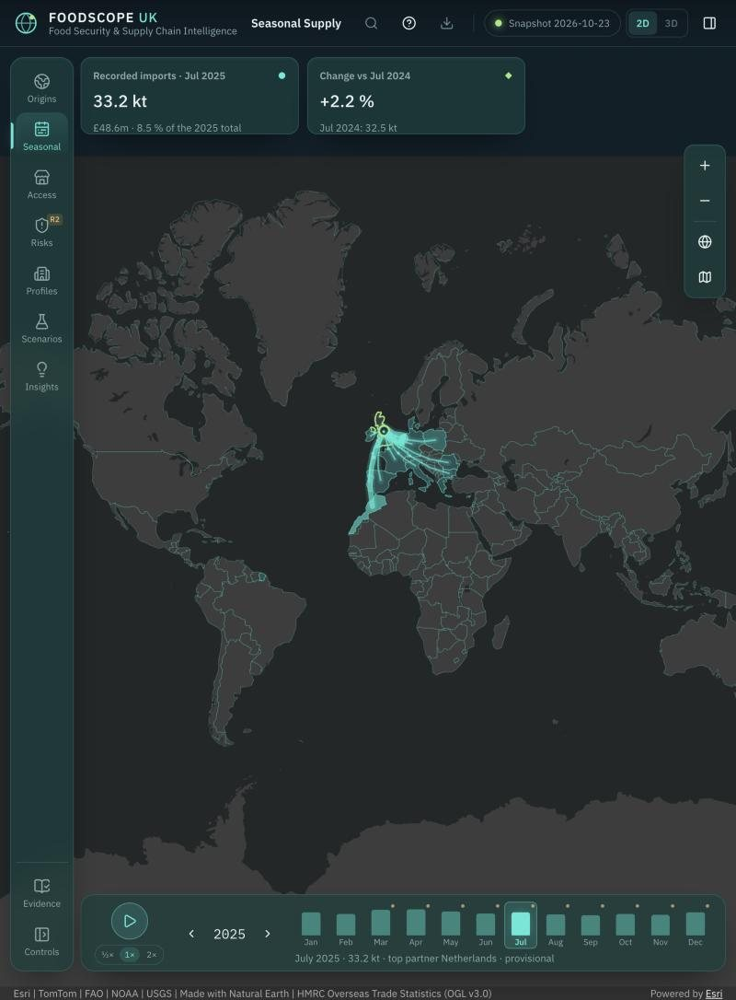
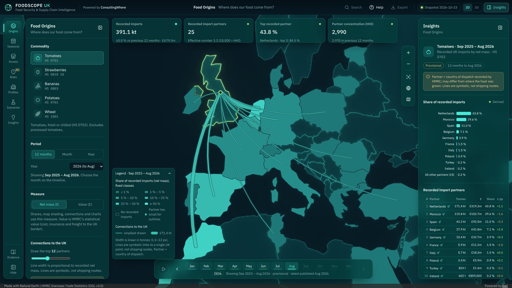
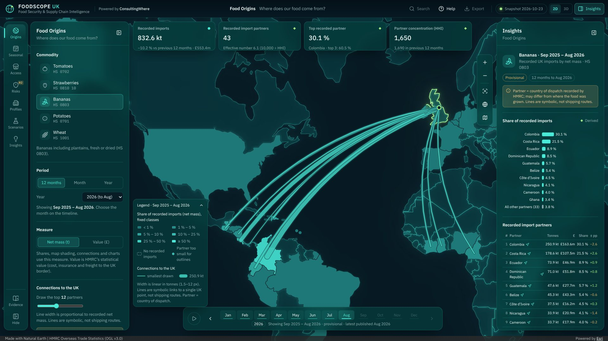
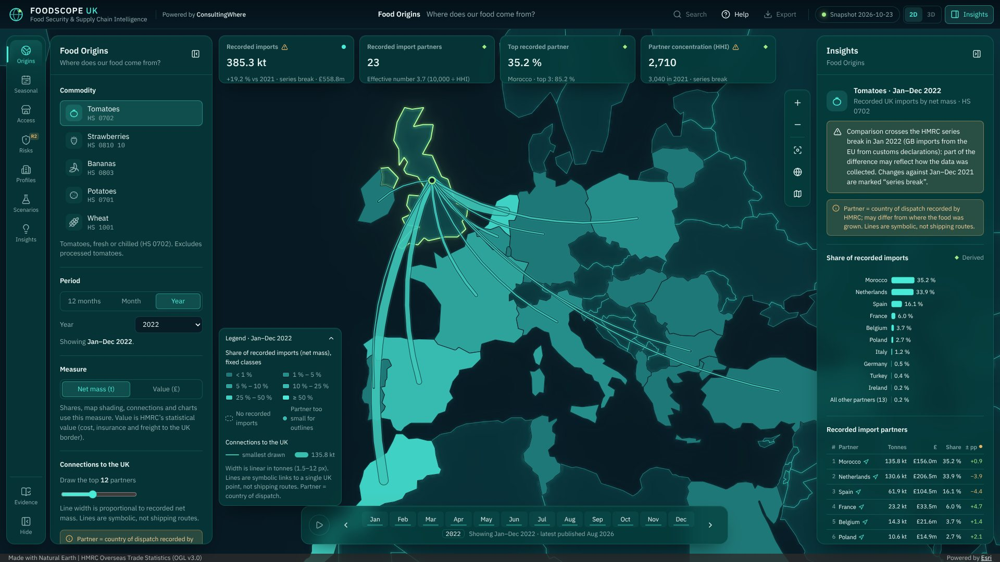
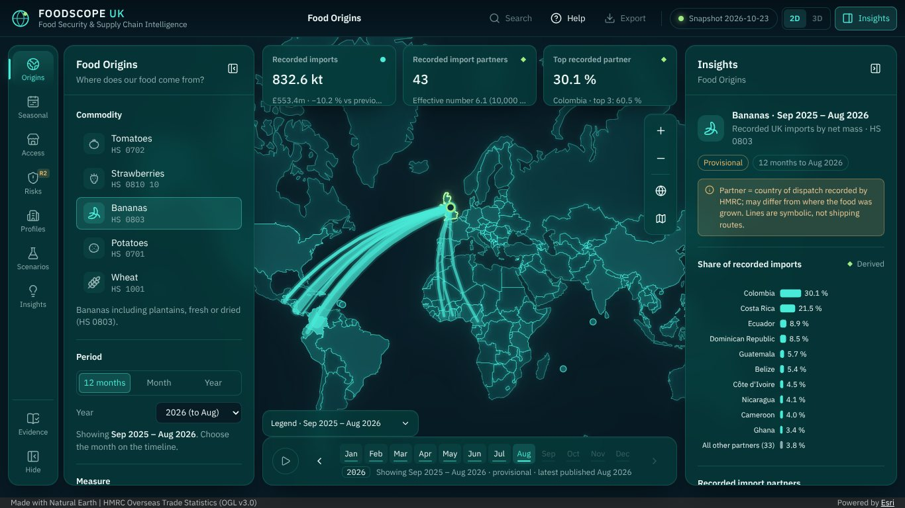
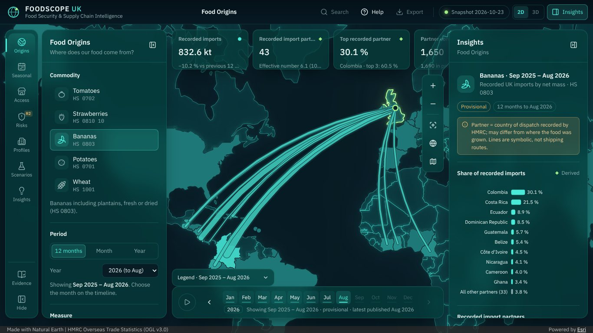
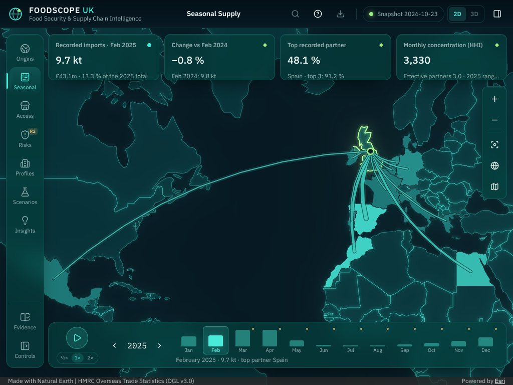

# Review after Stage 3: five improvements

- Date: 23 October 2026
- Branch: `improve/review-top-five`, from `main` after PR #5 (Stage 3) was merged and deployed.
- Brief (John): "Review the application as an award-winning UX designer, expert ArcGIS developer and food-security analyst. Identify the five highest-impact improvements to usability, cartography, performance and data integrity. Implement those improvements without removing existing functionality. Run the tests again."

## How the review was done
- **Live site:** the deployed site with the Esri basemap on a real GPU, in the desktop app's browser.
- **Screens:** sandbox builds at 1920 × 1080, 1366 × 768, 1024 × 768 and 390 × 844.
- **Code:** the map, data and model code.
- **Timings:**
  - The current and new builds were served over HTTP/2 with a 50 ms round trip added by the server.
  - Cold loads were run in headless Chromium, 7 runs each, reporting the median.
  - Chrome's DevTools network throttling was not used: it serialises latency across the ~400 module requests and produced 18 s loads that do not happen on a real HTTP/2 connection.
- **Colours:** checked with the dataviz palette validator against the two map surfaces, not by eye.

## Findings, ranked by impact

| # | Area | Finding | Evidence |
|---|---|---|---|
| 1 | Cartography and usability | The trade views opened on the whole world, so the connections, the app's flagship visual, were a small knot around the UK | Live site (screenshot below). At 1920 × 1080 the connections' box covered **1.9 %** of the free map area |
| 2 | Cartography and data integrity | Share classes were semi-transparent, so they took on the basemap's colour: the smallest class was nearly invisible against the land, and the map did not show the legend's colours | Smallest class against the land **1.27:1** (Esri dark grey) and **1.48:1** (offline outlines); the ordinal check needs at least 2:1 |
| 3 | Data integrity | Food Origins compared periods across the HMRC series breaks (Jan 2021, Jan 2022) with no warning. Value changes did not say they are in current prices | Tomatoes 2022 vs 2021: **+19.2 %**, with no caution on the cards, table or partner panel; Seasonal Supply already warned |
| 4 | Performance | The figures waited behind the map SDK: a three-step data chain started late and competed with about 410 ArcGIS modules | KPI cards ready at **2.85–2.92 s**, although the commodity file is 36 kB |
| 5 | Usability | Below 1440 px the KPI strip hid cards: concentration (HHI), a core food-security measure, vanished on 1366 px and 1280 px laptops, and tablets showed two of four cards | Screenshot below; CSS `nth-child(n + 4) { display: none }` |

Also seen but not in the five (backlog B21–B24):
- KPI detail lines are still shortened on narrow cards.
- About 410 small SDK modules load at start-up.
- Hover was checked only in the sandbox.

## The five improvements

### 1. The map frames the UK and its recorded partners (ADR-0018)
- **Opening view:** each trade view opens on a box around every drawn connection plus the whole UK. The box fits into the area left free by the panels, the KPI cards, the timeline and, on desktop, the legend column.
- **When it moves:** it reframes only when the commodity changes, so a user's pan or zoom survives month, year and measure changes.
- **On request:** a new map control, "Fit to recorded partners", and the **F** key re-apply the frame.
- **Seasonal Supply:** frames the year's leading partners, so the view stays still while the months play.
- **Result:** tomatoes open at zoom ≈ 4.75 instead of 2. The connections fill **85 %** of the free map area instead of 1.9 %.

### 2. One opaque share ramp, the same on the map, legend and heatmap (ADR-0019)
- **One ramp:** map fills now use the `--fs-seq-*` tokens the Seasonal heatmap already used. `src/styles/palette.ts` mirrors them, and a unit test fails if the map, the tokens or the legend CSS drift apart.
- **Validator results:**
  - before: smallest class 1.27:1 against the Esri land and 1.48:1 against the offline map, both FAIL;
  - after: 2.07:1 and 2.66:1, monotone and single-hue, PASS.
- **Separation:** navy separators divide neighbouring partners, and a navy casing keeps connection lines readable over bright fills.
- **Hover:** the country under the pointer is now emphasised with the SDK's highlight instead of rebuilding the renderer (E2E: renderer builds unchanged while hovering).

### 3. Comparability warnings (data integrity, P11)
- **KPI cards:** when a year-on-year comparison crosses an HMRC series break, the card shows an amber marker and the words "series break" in its detail line. The marker's accessible name and tooltip give the full sentence. This covers Food Origins imports and HHI, and Seasonal Supply's change card.
- **Insights panel:** a warning notice explains the break.
- **Partner table and partner panel:** the ± pp column is marked, and the partner panel tags its change.
- **Correct cases:**
  - 2022 vs 2021 crosses Jan 2022;
  - 12 months to Aug 2022 crosses both breaks;
  - Jan 2023 vs Jan 2022 crosses none.
- **Value comparisons:** a note says they are in current prices, not adjusted for inflation.
- **Detail lines:** the change now comes first, so it is the part that stays visible when a line is shortened.
- **Checks:** figures checked independently in Python: 385.3 kt vs 323.2 kt (+19.2 %); HHI 2,708 vs 3,036.

### 4. Figures before the map (ADR-0019)
- **Preload:** `index.html` preloads the data index.
- **Prefetch:** `main.tsx` loads the trade index, country points and the URL's commodity in parallel before React renders, using the hooks' own query options and validation.
- **SDK in parallel:** the map chunk is requested straight after.

Median of 7 cold loads over HTTP/2 with a 50 ms round trip; two rounds where shown, in seconds:

| Milestone | Before | After |
|---|---|---|
| Commodity snapshot loaded | 2.22–2.24 | 0.86–0.93 |
| KPI cards ready (Food Origins) | 2.85–2.92 | 1.06–1.37 |
| Partner table ready | 2.85–2.92 | 1.06–1.37 |
| Map with connections drawn | 2.41–2.43 | 2.66–2.72 |
| KPI cards, CPU slowed 4× | 5.41 | 2.68 |
| Map with connections, CPU slowed 4× | 5.32 | 5.23 |
| KPI cards ready (Seasonal Supply, Jul 2025) | 2.96 | 2.48 |

The figures now arrive 1.5–2.7 s sooner. The map with its connections is about as quick as before: up to 0.3 s later on a fast CPU, no slower with the CPU slowed.

### 5. Key figures are never hidden
- **Scrolling instead of hiding:** the KPI strip no longer hides cards at any width. When they do not fit, the row scrolls sideways with snap points and fades on the side with more cards.
- **Keyboard:** the row is keyboard-scrollable when it overflows (focusable region; axe passes).
- **Result:** HHI is back on laptops, and tablets show all four cards. 1920 px is unchanged.

## Verification

| Check | Result |
|---|---|
| `npm run check:banned` | OK |
| `npm run format` (repository files) | OK |
| `npm run typecheck`, `npm run lint` | OK, no warnings |
| `npm test` | **279 passed** (22 files; 244 before, +35) |
| `npm run gen:types` | no change |
| `cd pipeline && uv run pytest` | **45 passed** (pipeline unchanged) |
| `npm run build` (CDN) | OK; start-up JS 142.6 kB gzip (+1.4 kB); map chunk +0.7 kB |
| `VITE_ARCGIS_ASSETS=local npm run build` + `npm run e2e` | **47 passed** (38 before + 9 new in `tests/e2e/review.spec.ts`), including both axe accessibility checks and mobile 390 × 844 |

## Not verified
- **Real GPU and Esri basemap:** the framing flight, the hover highlight and the connection casing were seen only with software WebGL and the offline outline map in the sandbox. The colour contrast was computed against the Esri land colour sampled from the live site.
- **Real networks:** the timings come from a local HTTP/2 server with an added round trip, not real mobile networks or GitHub Pages' CDN.
- **Other browsers:** Firefox and Safari were not tested.
- **Preload match:** that the browser reuses the manifest preload (one request, no "preloaded but not used" warning) was checked in Chromium only.
