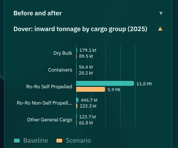
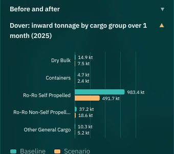
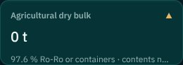
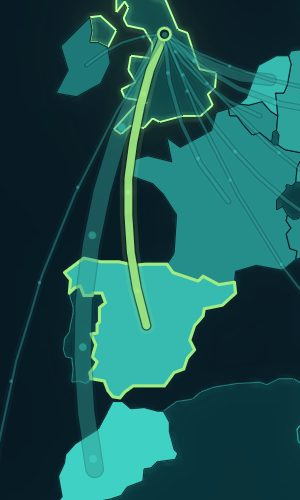
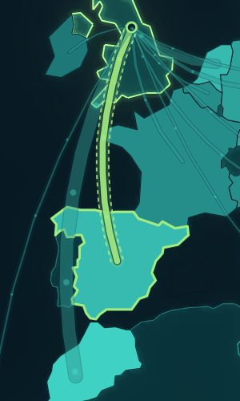
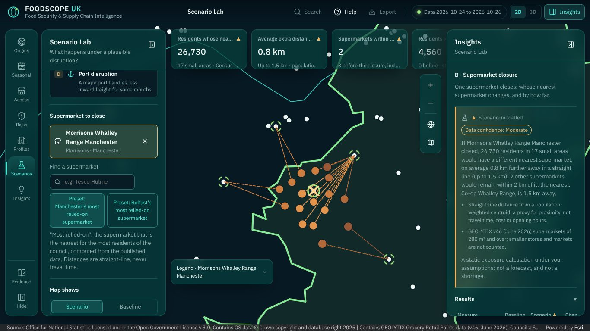
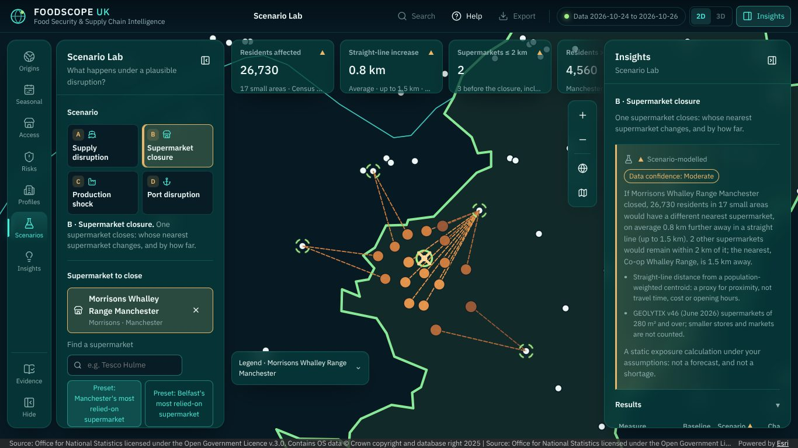
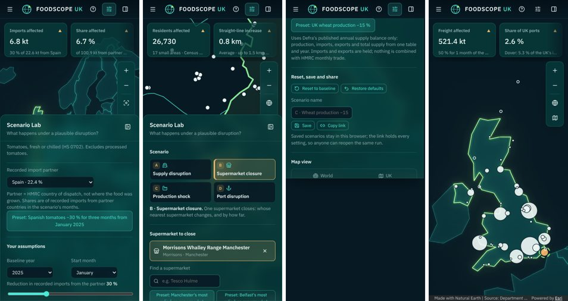

# Review of Stage 7 (Scenario Lab): verification and five improvements

- Date: 26 October 2026
- Branch: `review/stage-7`, from `stage/7-scenario-lab` (PR #22, d6c0d33). Committed locally first (John's instruction), then pushed with his agreement as PR #23 to main.
- Brief (John): "Review the completed FOODSCOPE UK development stage as a principal ArcGIS engineer, senior React developer, award-winning UX designer and UK food-security data analyst." Verify the new functionality and its data; implement the five highest-impact improvements without breaking anything; validate spatial operations, statistics, field mappings and attribution; check mobile, tablet, loading states, accessibility and map responsiveness; run every check; update the documentation and the roadmap; commit; do not begin Stage 8.

## Merge state found

PR #21 (data step) merged to main at 13:50. PR #22 (the module) merged at 17:08, but into `data/stage-7-inputs`, its stacked base. GitHub only retargets a stacked pull request when the branch below is deleted, and that branch was kept.

So main and the live site have the Stage 7 data but **not the Scenario Lab**. A pull request from `review/stage-7` (or `data/stage-7-inputs`) to main is needed. The same happened with PR #16 in Stage 6.

## How the review was done
- **Data:** independent scripts over the published files (numpy and pyproj; no app or pipeline code).
- **Screens:** production builds in the sandbox (software WebGL, offline outline map) at 1920 × 1080, 1366 × 768, 1024 × 768, 820 × 1180 and 390 × 844, each scenario with its preset.
- **Code:** the scenario models, map controllers, charts and controls.
- **Timings:** Chrome DevTools profiles of unminified builds, and cold loads with a 50 ms added round trip (Vite's HTTP/1.1 preview), at full speed and with the CPU slowed 4×.
- **Accessibility:** axe on every scenario at three widths, with the panels open.

## 1. Verification: functionality and genuine data

| Check | Method | Result |
|---|---|---|
| Three nearest supermarkets of every small area | Brute force over all supermarkets of each part, from the published national-grid coordinates | All 46,844 areas (GB 43,064; NI 3,780) match within 1.7 m (coordinate and distance rounding); no index mismatch beyond ties |
| Any single closure | Brute-force nearest with the area's nearest supermarket removed | Equals the published second nearest for 46,844 / 46,844 areas: three nearest are enough for any one closure, so the app's linear pass is exact |
| Grid vs WGS84 points | pyproj EPSG:4326 → 27700 / 2157 | Stores within 0.5 m, areas within 1.1 m |
| Supermarkets | Against the local stores snapshot (GEOLYTIX v46) | 7,173 = 7,195 of 280 m² and over less 22 Crown Dependency stores; size bands only 280 m² and over |
| Populations | Sum of the closure inputs by nation | England 56,490,056; Wales 3,107,545; Scotland 5,439,565 (Census 2022); Northern Ireland 1,903,168 (the build checks them against the published totals) |
| Scenario A, B, C, D figures | Independent scripts (stage 7 report) | Unchanged: 6.8 kt, HHI 2,570 → 2,660; 26,730 residents, +0.8 km; 1.8 Mt; 521.4 kt |
| Scenario D, new figures | Independent script over `ports.json` | Dover: Ro-Ro and containers 12,304.196 of 12,606.921 kt (97.6 %); 1,025.4 kt in one month, 512.7 kt at −50 %. Liverpool: agricultural dry bulk 1,640.548 kt, 17.2 % of the major ports' 9,534.029 kt |
| Field mappings | Every field the app reads is in the ajv-validated schemas (`scenario-closure`, `risk-ports`, `risk-port-entry`, `uk-production`, `trade-snapshot`) and in 03-DATA-SOURCES (S11, S15–S19, S23, S32) | No unverified field |
| Attribution | `view.attributionItems` in the browser | **Two gaps, fixed below**: the ports (DfT; EMODnet under CC BY 4.0) had no map credit in Scenario D or the Risk Explorer, and Scenario B credited only GEOLYTIX and the council boundaries for the closure areas |

## 2. Findings, ranked by impact

| # | Area | Finding | Evidence |
|---|---|---|---|
| 1 | Analytical integrity | Scenario D's cargo-group chart ignored the duration. A one-month disruption at −50 % was drawn as a whole year halved: Dover's Ro-Ro 11.8 Mt → 5.9 Mt, beside cards saying 521.4 kt. "Agricultural products affected: 0 t" at Dover read as "no food through Dover". DfT's category 23 is dry bulk; lorries and containers carry no commodity in DfT's data | Screenshot below; `portGroupChart` applied `(1 − r)` to annual values |
| 2 | Cartography | Scenario A's dashed baseline ("ghost"), promised by the legend, was invisible at the preset's −30 %. It was drawn as a `SimpleLineSymbol` at 0.75 × the baseline width, under a scenario line whose casing and glow are wider | Crop below |
| 3 | Performance | Opening the Scenario Lab, Scenario A's data waited for the lazy chunk; once added to the start-up prefetch, panels mounting during the chunk load cancelled it and the files were fetched twice. Every slider step built thousands of new `Intl.NumberFormat`s | Network log; CPU profiles |
| 4 | Usability | On 1366 × 768 laptops the four tall scenario cards filled the top of the panel; KPI labels were cut to "Residents whose nea…", "Supermarkets within …"; Duration and Recovery sliders were 130–160 px long beside full-width ones; "+0.0 km" stood beside "+6.1 %" | Screenshots below |
| 5 | Accessibility | Sliders and presets changed every card without moving focus, with no status message (WCAG 4.1.3); slider hit areas were under 24 px on touch screens (WCAG 2.5.8). axe found no serious or critical issue | axe at 390, 1024, 1920 px |

## 3. The five improvements

### 1. Scenario D: the disrupted months and DfT's categories (analytical integrity)
- **The chart covers the disrupted months.** It charts annual tonnage × months ÷ 12, the same even spread as the cards and the table: Dover's Ro-Ro for one month is 983.4 kt → 491.7 kt. Its title names the window, for example "over 1 month (2025)".
- **"Agricultural dry bulk".** The card and row are renamed. At Dover the card shows 0 t with "97.6 % Ro-Ro or containers · contents not recorded": the share leads, so it stays visible when the detail line is cut. A port with no unitised freight says "None recorded as dry bulk".
- **Unitised freight row.** A results row adds Ro-Ro and container freight over the disruption, labelled "contents not recorded" and "any origin". DfT does not split cargo groups by origin.
- **Tests:** unit tests for `overMonths` and `portUnitised`; model tests for Dover and Liverpool; a component test; E2E.

### 2. Scenario A: the baseline outline is visible (cartography)
The ghost is now CIM, in the flow line's own units (`ghostSymbols.ts`, SDK-free and unit-tested). It has two parts:
- a faint body at the baseline line's full extent, under the scenario line;
- two dashed edges, offset ± half that extent, above the scenario line.

The narrowing reads at any reduction, and matches the legend's dashed outline sample. The flows layer reports the ghost (`data-flow-ghosts`) for E2E.

 

### 3. Scenario A loads with the page; faster slider steps (performance)
- **Prefetch:** Scenario A, the Scenario Lab's default, is in the start-up prefetch (ADR-0019 amendment), with the same keys and validators as Food Origins. Its snapshot is requested about 0.34 s after navigation.
- **Start-up loads always complete:** they no longer pass the AbortSignal, which had let panels mounting during the chunk load cancel and repeat them.
- **Formatters:** number formatters are cached app-wide.
- **Search:** the supermarket search folds each store's text once, not on every keystroke.

| Measure | Before | After |
|---|---|---|
| Scenario A, first key figures, cold load (median of 10) | 4.5 s | 3.9 s |
| Same, CPU slowed 4× (median of 5; wide spread) | 11.8 s | 4.9 s |
| Duplicate start-up requests (index, country points) | 2 | 0 |
| `buildImportModel`, 20 slider steps (profile) | 201–207 ms | 63–74 ms |
| React work, 20 slider steps | 739–774 ms | 601–634 ms |
| Supermarket search, per keystroke (7,173 stores, Node) | 2.9 ms | 0.5 ms |
| Shell bundle | 479.0 kB (146.8 kB gzip) | 480.3 kB (147.0 kB gzip) |

Opening Scenario B still runs one long task: parsing and validating the closure inputs and building the store list. It took 0.15–0.5 s at full speed in software WebGL. A worker would not help as things stand, because a structured clone back costs more than the 15–30 ms parse. To measure on a phone first (B59).

### 4. The Scenario Lab fits laptops and tablets (usability)
- **Compact picker:** a 2 × 2 picker (letter, icon, short title), with the active scenario's full title and description under it. The settings start about 210 px higher.
- **Sliders:** full width whatever their label. The cause was `.field-row`'s space-between sizing the grid column to the label. Paired selects stay inside the panel.
- **Short KPI labels** (`KpiCard.shortLabel`): "Residents affected", "Straight-line increase", "Supermarkets ≤ 2 km", "Imports affected", "Freight affected"… The full label stays each card's accessible name and leads its tooltip. The council and "average" move to the detail line.
- **Small changes:** a real change below the 0.1 km step reads "+< 0.1 km" (P13).

### 5. Results reach screen-reader users (accessibility)
- **Status message:** once the settings rest (800 ms; one message per drag, none on first display), a polite status message says, for example: "Scenario A updated. Recorded imports affected: 22.6 kt; Share of recorded imports affected: 22.4 %."
- **Touch targets:** sliders get a 28 px hit area on touch screens.

## 4. Validation fix: map credits for data drawn as graphics
- **Ports.** GraphicsLayers carry no `copyright`, so the ports' source never reached the attribution bar. A credit layer now carries it: an empty GeoJSONLayer with the ports dataset's attribution, shown and hidden with the ports. This covers the Risk Explorer's logistics view and Scenario D, crediting DfT (OGL) and EMODnet (CC BY 4.0, which requires it).
- **Closure areas.** Scenario B's store layer now credits both closure datasets: ONS Census, Scottish Government centroids, MHCLG IoD 2025, NISRA, OSNI and GEOLYTIX. Each sentence appears once (`mergeAttributions`).

## 5. Mobile, tablet, loading and responsiveness
- **Layout.** At 1920, 1366, 1024, 820 (portrait) and 390 px there is no horizontal page scroll, and every scenario's controls and results are reachable. Tablets open the panels from the rail (Controls, Evidence); phones use the bottom sheet.
- **Loading states.**
  - Scenario B shows its progress ("1 of 2 files") and the shared error states.
  - A missing Defra balance (oranges) shows Defra's reason.
  - A scenario window outside the snapshot shows "No month of the scenario is in the trade snapshot".
- **Map responsiveness.** Framing happens once per commodity, store or port. The closure fade is under 280 ms (none with reduced motion), and the flow tween under 320 ms.
- **Seen, not changed** (backlog):
  - B60: on tablets, the Evidence dialog's long source URLs overflow.
  - B61: on phones, the sheet covers most of the map in Scenarios B and D.
  - B62: at 1366 px, the fourth KPI card sits under the open Insights panel.

## 6. Checks run

| Check | Result |
|---|---|
| `npm run typecheck`, `npm run lint`, `npm run format`, `npm run check:banned` | Pass |
| `npm test` | **616 passed** (44 files; 604 before) |
| `VITE_ARCGIS_ASSETS=local npm run build`, `npm run build:e2e-basemap` | Pass |
| `npm run e2e` (all specs, software WebGL) | **78 passed** (16.6 min), including the new checks: Scenario A's ghost, the closure and port credits, Scenario D's dry-bulk card and one-month chart. After a last wording change to the dry-bulk card, `scenarios.spec.ts` and `responsive.spec.ts` were run again: 12 passed |
| `cd pipeline && uv run pytest` | 318 passed, 1 skipped (pipeline unchanged) |
| axe, every scenario at 390, 1024 and 1920 px, panels open (final build) | No serious or critical violations; moderate only, both shared with the shell: the skip link outside a landmark and the KPI cards' heading order |

## 7. Not verified
- **Real GPU and the Esri basemaps** (B48, B64): the ghost's CIM offset and dash effects over light grey and imagery, the closure symbols, and the attribution bar's look. The sandbox has software WebGL and the offline outline map. The ghost and the credits were checked there, in screenshots and through `view.attributionItems`.
- **Real devices and networks:** timings come from a local HTTP/1.1 preview with an added round trip, not GitHub Pages' CDN or a phone. Touch targets were checked in CSS, not on a device.
- **Screen readers:** the status message was tested in jsdom (role, text, timing), not with NVDA or VoiceOver.
- **Other browsers:** only Chromium was used.

## 8. Recommendations before Stage 8
1. **Get Stage 7 onto main.** Merge PR #23 (base main), then run the live checks (B48, B64) on the deployed site.
2. **Measure B59 on a real phone.** If opening Scenario B blocks for more than about 200 ms there, move the closure inputs to typed-array columns parsed in a worker.
3. **Settle B56 and B57 with John** (several closures at once; the Short Straits) before the Stage 8 brief: both change what the Consulting Insights pages could cite.
4. **Fix the shared mobile layout** (B61) in Stage 9 hardening; it affects every map-led module.
