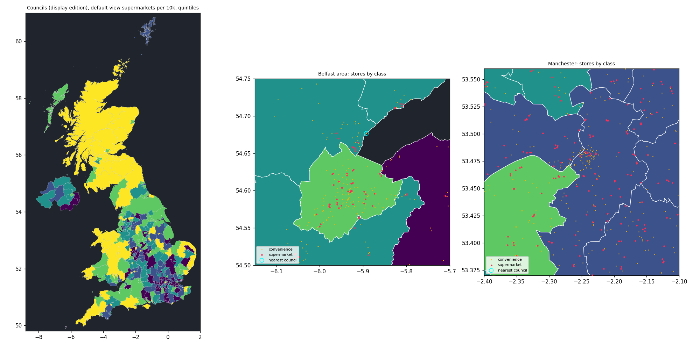

# Pre-Stage 4 data step: councils, stores and population

- Date: 24 October 2026
- Branch: `data/stage-4-inputs`, from `improve/review-top-five` (PR #6, still open)
- Brief (John): "What data work is needed before stage 4". John then attached:
  - the GEOLYTIX retail points (v46);
  - the May 2025 council boundaries (BFE, shapefile and FileGDB);
  - the ONS chain-supermarket counts (S12).

  His reply to the proposed approach: "i agree with your suggestions and let the pipeline fetch the mid-year estimates".
- Scope: the LAD and GEOLYTIX items moved out of Stage 3 (roadmap §5.3), gates G5 and G7, and decision D5. **Stage 4 itself is not started**: no app code changes. The outputs are built and committed, but they are not yet in the app's data index.
- **John's decisions on the open questions (24 Oct 2026)**, applied to the outputs in this report:
  - "leave out wholesale stores and non-food stores": 116 stores (Costco 29, Makro 23, M&S Outlet 33, Asda Living 30, M&S Clothing 1) are not published;
  - "show the 125 Channel Islands and Isle of Man stores on the map without a council": they are in the store layer with no council (`lad: null`, `councilMatch: "none"`, `crownDependency` named) and in no council count;
  - "each kind of data keep its own newest date, so trade and stores refresh on their own schedules": recorded for Stage 4, which changes `publish` to take each dataset family from its newest snapshot (ADR in Stage 4).

## What was built

### Inputs

All inputs are committed byte for byte, with checksums.

| Input | Source | How it arrived | Where |
|---|---|---|---|
| GEOLYTIX Grocery Retail Points v46 (June 2026), 19,299 rows | S11 | John | `pipeline/raw/geolytix/v46-202606/` |
| Council boundaries May 2025, **BFE** FileGDB (full resolution, to the low-water line), 361 councils | S14 | John | `pipeline/raw/ons-lad-boundaries/may-2025-uk-bfe-v2/` |
| Council boundaries May 2025, **BGC** (20 m, clipped to the coastline), 8 pages of 50, count checked (361) | S14 | `fetch-ons` on GitHub Actions (run 40078889712) | `pipeline/raw/ons/2026-10-24/` |
| ONS mid-2025 population estimates, UK (`mye25tablesuk.xlsx`, released 1 Oct 2026) | S18 | `fetch-ons` on GitHub Actions (run 40077877447) | `pipeline/raw/ons/2026-10-24/` |
| ONS LAD 2022 → 2023 lookup | S14 | `fetch-ons` on GitHub Actions | `pipeline/raw/ons/2026-10-24/` |
| ONS chain supermarkets by council (7 March 2024) | S12 | John | `pipeline/raw/ons-supermarkets/2024-03-07/` |

Each provided file has an `index.json` recording:
- its original name;
- its size and SHA-256;
- its licence and attribution;
- when it reached the build session.

The build refuses any file that no longer matches its index.

### Outputs

The outputs come from `foodscope-pipeline build-local --snapshot 2026-10-24`, which runs offline in about 16 s. They are written to `pipeline/derived/2026-10-24/`.

| File | Contents | Size (gzip) |
|---|---|---|
| `lad-2025-uk.geojson` | 361 councils for display. Steps: BGC → coverage clean (1 cm) → coverage simplify at 150 m (EPSG:27700) → WGS84 at 6 dp. Properties: `code`, `name`, `nameWelsh`, `nation` | 2.7 MB (0.87 MB) |
| `stores.geojson` | 19,183 stores: 19,058 in UK councils and 125 in the Crown Dependencies (no council). Properties: GEOLYTIX `id`, `retailer`, `fascia`, `name`, `address`, `town` and `postcode`, plus `sizeBand`, `storeClass`, `format`, `lad`, `councilMatch`, `crownDependency` and `coordinateSource` | 8.1 MB (0.96 MB) |
| `lad-indicators.json` | Per council: mid-2025 population, land area, a comparability note, and store counts for each size band × format pair (28 columns) | 71 kB (12 kB) |
| `*.provenance.json` | One record per output in the manifest's dataset shape, validated against `schemas/manifest.schema.json` | — |

- **Size budget:** both web layers fit architecture §10. The budget is 2 MB gzip for stores; LAD boundaries are part of the 2.5 MB initial-data budget.
- **Schemas:** `schemas/stores.schema.json`, `lad-boundaries.schema.json` and `lad-indicators.schema.json`, with types generated in `src/types/generated/`.
- **Reports** in `pipeline/reports/`:
  - `local-accounting-2026-10-24.json`;
  - `local-qa-2026-10-24.json`;
  - `ons-s12-comparison-2026-10-24.json`, also as `.csv` per council.

### Row accounting

Every lost row has a reason.

| Step | In | Out | Rejected |
|---|---|---|---|
| Read BFE / BGC boundaries | 361 / 361 | 361 / 361 | — |
| Read GEOLYTIX rows | 19,299 | 19,299 | — |
| Classify (D5) | 19,299 | 19,299 | — (an unknown size band would stop the build) |
| Locate | 19,299 | 19,299 | — (1 store placed from British National Grid) |
| Assign to a council | 19,299 | 19,299 | — (19,174 in a council; 125 in the Crown Dependencies, kept with no council: Guernsey 30, Jersey 51, Isle of Man 44) |
| Leave out formats (John's decision) | 19,299 | 19,183 | 116: wholesale and membership 52, mainly non-food 64 |
| Population rows → councils | 361 | 361 | — |
| S12 councils → May 2025 councils | 376 | 374 | 2 (Channel Islands, Isle of Man) |

## Decision D5: store classes (agreed with John, 24 Oct 2026)

**Class** comes from the delivered `size_band` only. 280 m² is the Sunday trading threshold that ONS also uses (S12, note 5).

**Format** comes from the `fascia` (`pipeline/foodscope_pipeline/config/store_classes.json`). The forecourt, travel and wholesale lists follow the GEOLYTIX groupings that ONS prints in S12's Notes worksheet, where Morrisons Select is a forecourt format.

Stores in UK councils:

| Format | Convenience (under 280 m²) | Supermarket (280 m² and over) |
|---|---|---|
| Standard (in the default view when ≥ 280 m²) | 10,622 | **7,171** |
| Petrol forecourt | 1,066 | 2 |
| Motorway services | 86 | — |
| Station and airport | 47 | — |
| Hospital | 64 | — |
| Wholesale and membership (Costco 29, Makro 23): **left out** (John, 24 Oct 2026) | — | (52) |
| Mainly non-food (M&S Outlet 33, Asda Living 30, M&S Clothing 1): **left out** (John, 24 Oct 2026) | — | (64) |

The Crown Dependencies add 125 published stores with no council: 100 convenience and 3 forecourt stores under 280 m², and 22 supermarkets.

Size bands in UK councils, before leaving out the 116 stores:

| Band | Stores |
|---|---|
| Under 280 m² | 11,885 |
| 280–1,400 m² | 4,491 |
| 1,400–2,800 m² | 1,219 |
| 2,800 m² and over | 1,579 |

GEOLYTIX's size band and its fascia do not always agree. Among all delivered rows:
- fascias that ONS groups as convenience, but with a band of 280 m² or more: Co-op 548, Tesco Express 94, Sainsbury's Local 27, Budgens 17, Little Waitrose 15, Aldi Local 12;
- forecourt stores with a band of 280 m² or more: 2.

The class follows the size band as delivered; the QA report lists these cases.

## Population and land area (S18)

- **Source:** ONS mid-2025 estimates for all four nations at one reference date, 30 June 2025, so per-capita figures compare across nations on population.
- **Tables used:**
  - MYE2 "All ages" for population;
  - MYE5 for land area: land excluding inland water, from the January 2025 Standard Area Measurements for Great Britain and NISRA's estimate for Northern Ireland.
- **Checks in the build:**
  - MYE2 equals MYE5's population for every council;
  - the councils sum to the UK row, 69,483,939.
- **Barnsley and Sheffield:**
  - ONS's estimates are on April 2024 boundaries (MYE note 10).
  - The Barnsley and Sheffield (Boundary Change) Order 2024 (SI 2024/1328) moved the Oughtibridge Mill development from Barnsley to Sheffield. ONS gave both councils new codes in 2025: E08000016 became E08000038, and E08000019 became E08000039.
  - ONS's own note 18 says the population estimates do not account for this change.
  - Both councils take their old-code figures, and each carries a note saying so.

## Gates

- **G5 ✅ ONS/OS attribution for boundaries.**
  - Boundaries: "Source: Office for National Statistics licensed under the Open Government Licence v.3.0. Contains OS data © Crown copyright and database right 2025".
  - ONS tables and lookups: the first sentence only.
  - The wording is recorded in every provenance record that uses them.
- **G7 ✅ GEOLYTIX schema, store-class values, Northern Ireland coverage, `bng_*` for Northern Ireland.**
  - **Columns:** the same 17 as v31, checked exactly by the reader.
  - **Size bands:** four values, exactly the labels S12 uses.
  - **Fascias:** 53 values.
  - **Northern Ireland:** 627 BT postcodes, and 725 stores assigned to the 11 NI councils.
  - **`bng_e`/`bng_n`:** for every store with WGS84 coordinates, these equal the WGS84 point projected to British National Grid with PROJ's default OSGB36 transformation. The median difference is 0.00 m in both Great Britain and Northern Ireland. So in Northern Ireland they are British National Grid values derived from WGS84, not Irish Grid.
  - **BNG mismatches:** three Great Britain stores differ by 48–67 m (Tesco Penwortham, Asda Altrincham, Asda Worksop). The build uses WGS84, so these do not affect it.
  - **`pqi` values:** Rooftop 19,254, Building 28, Third Party 17.
  - **Licence:** GEOLYTIX describes the data as "completely free and open to use data" (Q1 2026 blog page, read 24 Oct 2026). There is no named licence.

## Checks on the outputs

- **Independent re-assignment.** I re-assigned every store with GEOLYTIX's own BNG coordinates (no reprojection) and `contains_xy` on the BFE polygons, in a separate script outside the pipeline (not committed). 19,172 of the 19,174 assignments agree. The other 2 are the two shore-front stores below, which a strict inside test leaves unassigned. Belfast has 142 stores and Manchester 152 by both methods (140 and 150 published, after leaving out wholesale and non-food stores).
- **Population by nation.** Equal to ONS MYE1: England 58,834,812, Wales 3,175,181, Scotland 5,545,500, Northern Ireland 1,928,446.
- **Shore-front stores.** Two Northern Ireland stores lie 14 m and 20 m outside every council boundary line: Spar Carnlough (Harbour Road) and Spar Whiteabbey (Shore Road). They take the nearest council (Mid and East Antrim; Antrim and Newtownabbey) and are flagged `councilMatch: "nearest"`. The rule allows up to 50 m.
- **Boundaries for display:**
  - 533,561 vertices become 121,517;
  - 3,379 island parts under 1 ha that touch no other council are dropped (939 ha in all);
  - cleaning changed no area.
  - After projection and 6-dp rounding, two pairs of neighbours overlap by slivers. One is 0.04 m² (Hartlepool and Stockton-on-Tees); the other is 3.9 m² (Portsmouth and Fareham). Both are measured in the QA report and invisible at display scales.
- **Stores near council edges.** 14 stores are within 10 m of another council. A positional error of a few metres could change their council.
- **Determinism.** `tests/test_local_build.py` rebuilds everything from the raw files and requires byte-identical outputs and reports.
- **Visual check.** Councils coloured by default-view supermarkets per 10,000 residents (quintiles, for checking only); Belfast and Manchester with stores by class. There are no gaps, the coasts are clipped, and Belfast Lough is water.

## Comparison with ONS S12 (validation only)

S12 counts every GEOLYTIX format of its time, plus 52 stores from retailers GEOLYTIX did not track, on the councils of the time. To compare like with like:
- S12 councils were mapped to May 2025 councils: 355 have the same code, 17 merged in 2023 (via the ONS lookup), and 2 changed code in 2025.
- Our side counts every store in each council, including the wholesale and non-food stores the app leaves out, because S12 counts them too.

| | Ours (v46, June 2026) | S12 (March 2024) | Difference |
|---|---|---|---|
| UK councils | 19,174 | 18,069 | +1,105 (+6.1 %) |
| England | 15,540 | 14,673 | +5.9 % |
| Wales | 952 | 919 | +3.6 % |
| Scotland | 1,957 | 1,845 | +6.1 % |
| Northern Ireland | 725 | 632 | +14.7 % |
| Channel Islands | 81 (rejected) | 59 | +22 |
| Isle of Man | 44 (rejected) | 32 | +12 |

**Spread across councils:** the median difference is 6.7 %. 147 councils are within 5 %, 261 within 10 %, 346 within 20 %, and 15 are further apart. The 15 include the Isles of Scilly (1 against 2), Lisburn and Castlereagh (52 against 37) and Rutland (12 against 9).

**What explains the difference** (from the per-type and per-band tables in the report):
- **Convenience growth:** ONS's convenience type is +1,064 stores.
- **Retailers ONS did not group:**
  - Centra: 102 stores, all in Northern Ireland;
  - Cook: 117 stores;
  - two M&S formats.

  None of these appears in the S12 groupings. Centra alone (102) is more than Northern Ireland's difference (+93).
- **Symbol groups:** −259. In v46 this group is Spar and Eurospar; S12 also counted SuperValu and Tuffins, which v46 does not carry.
- **Size bands moved between editions:**
  - under 280 m²: +1,236;
  - 1,400–2,800 m²: −222;
  - 2,800 m² and over: +161.

  GEOLYTIX appears to have revised some store sizes.
- **Not comparable per head:** S12 per-10,000 figures use Census 2021/2022 populations. Ours use mid-2025. For example, Belfast is 3.65 in S12 against 4.04 in ours, and Manchester 2.57 against 2.58. The report shows both for unchanged councils only and never combines them.

This report compares all-format totals and size bands, the levels at which S12 and GEOLYTIX can be matched. Stage 4's exit criterion ("LAD totals reconciled and differences from ONS S12 explained") should repeat the comparison for whatever counts Stage 4 displays.

## Commands run and results

| Command | Result |
|---|---|
| `uv run foodscope-pipeline fetch-ons --snapshot 2026-10-24` (GitHub Actions) | Runs 40077877447 and 40078889712: OK, committed by the workflow |
| `uv run foodscope-pipeline build-local --snapshot 2026-10-24` | OK, 10 files, about 16 s |
| `cd pipeline && uv run pytest` | **103 passed** (57 before this step) |
| `npm run gen:types` | 3 new generated files; no change to existing ones |
| `npm run typecheck`, `npm run lint`, `npm run format`, `npm run check:banned` | OK |
| `npm test` | **279 passed** (no app change) |
| `npm run build` | OK |
| `VITE_ARCGIS_ASSETS=local npm run build` + `npm run e2e` (sandbox) | **47 passed** (no app change) |
| CI on PR #7 | The data pipeline job passed on every run, including the byte-identical rebuild on Python 3.12. The web job's E2E step failed intermittently with no app change: it failed in run 40080616364 (then passed on a rerun) and in run 40083044884. Run 40084267992 passed, 47 of 47, with no flaky tests. The failing test is unknown because the job log and Playwright report could not be downloaded from the sandbox. Playwright now also reports to GitHub annotations on CI, so the next failure names its test (backlog B29) |

## Not verified, and why

- **Whether the shapefile edition matches the FileGDB.** I used only the FileGDB, the smaller download. Both editions hold 361 councils with the same fields; I did not compare their geometries.
- **The GEOLYTIX user guide.** I did not find or read one. The meaning of `pqi` comes from its values only, and `open_date` is not used.
- **Why the two Northern Ireland stores fall outside the boundary.** The NI coastline in the BFE edition may follow a different water line, or the stores' positions may be a few metres off. I did not establish which.
- **The app.** None of this is visible in the app yet. Nothing was checked in a browser because nothing changed there.

## Open questions for John

All three were answered on 24 Oct 2026 (top of this report):

1. Wholesale and mainly non-food stores: left out of the app.
2. Publishing: each kind of data keeps its own newest date; Stage 4 implements it with an ADR.
3. Crown Dependency stores: shown on the map without a council.
